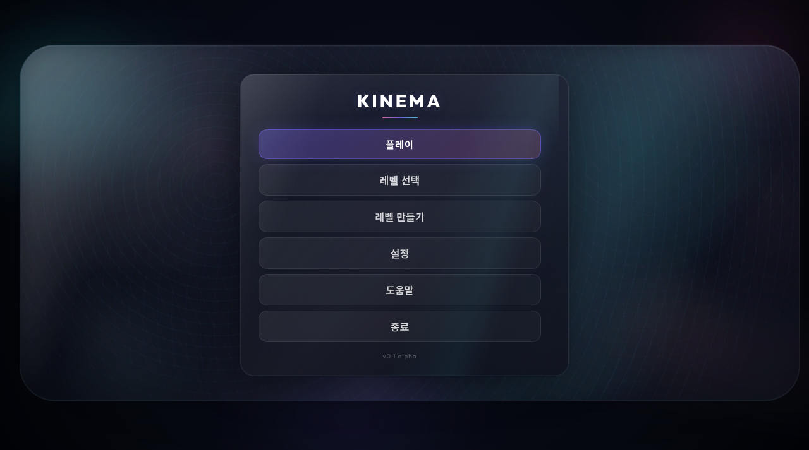

# 🧩 KINEMA | 한글판 게임플레이 실험실

[▶ 한국어판 실행](https://sigco3111.github.io/Kinema/) · [원본 README](README.en.md)

3인칭 게임플레이 실험실과 브라우저 레벨 편집기 (알파)입니다. 원작의 출처와 내부 식별자는 유지하고 사용자 화면을 한국어로 옮긴 포크입니다.

> **사용 전 확인:** 월드 검증 미완료입니다. 기존 144개 테스트와 한글 메뉴 확인 기록은 있지만 검증 브라우저에서 월드 진입 후 렌더링이 멈췄습니다. 아래 월드·편집기 설명은 제공 기능이며 이번 환경에서 정상 동작을 확인했다는 뜻이 아닙니다.

## 실행 화면



> 한국어 메인 메뉴만 캡처했습니다. 실제 월드 플레이 성공을 뜻하지 않습니다.

## 주요 특징

- 이동·이단 점프·물리 상호작용
- 잡기·던지기와 차량·드론
- 브러시·속성 패널·GLB 가져오기
- WebGPU·WebGL 그래픽 비교

## 빠른 시작

1. 한국어 메뉴 확인
2. 설정 확인
3. 플레이 선택
4. 월드가 정상 표시될 경우 화면 클릭

## 기술 스택

TypeScript · Three.js · Rapier · Tone.js · navcat · Vite · Vitest · Playwright · Biome

## 문서 안내

- 아래에서 상세 조작, 한글화 범위, 개발·재배포 방법과 권리 고지를 확인하세요.
- `README.en.md`는 보존된 원본 설명입니다. 원작 기능과 이 포크의 검증 범위는 다를 수 있습니다.
- `korean-localization.patch`는 번역 변경 기록입니다.

---

TypeScript, Three.js, Rapier 물리 엔진으로 만든 3인칭 게임플레이 실험실과 브라우저 레벨 편집기입니다. **2600th/Kinema** 원작의 한국어 포크이며 원본은 MIT 라이선스입니다.

**현재 상태:** 한국어 메뉴·설정과 144개 테스트는 확인했지만, 검증 브라우저에서 월드 진입 시 렌더링이 멈췄습니다. 이 프로젝트는 완성된 실행 결과로 표시하지 않습니다.

## 플레이

`플레이`를 누르면 절차 생성 전시장에 들어갑니다. 화면을 클릭하면 마우스 시점 조작과 소리가 켜집니다. 계단, 경사로, 이단 점프, 잡기·던지기, 문·신호기, 차량·드론, 이동 발판, 재질, 시각 효과, 경로 탐색 구역을 돌아보세요.

| 기능 | 조작 |
|---|---|
| 이동 | W A S D / 방향키 |
| 점프·이단 점프 | Space |
| 앉기 | C |
| 달리기 | Shift |
| 잡기·상호작용·탑승 | F |
| 던지기 | 마우스 왼쪽 버튼 |
| 드론 고도 | E / Q |
| 시점·확대 | 마우스 / 휠 |
| 일시 정지 | Esc |
| 편집기 | F1 |
| 그래픽 프로필 | F6 |
| 디버그 | ` |

## 레벨 편집기

`레벨 만들기` 또는 F1으로 편집기를 엽니다. 블록, 바닥, 기둥, 계단, 경사로, 문틀, 트리거, 시작 지점을 배치하고 속성 패널에서 위치·회전·크기·물리·재질을 바꿀 수 있습니다. Ctrl+P / Cmd+P로 플레이 테스트합니다. 저장 레벨은 브라우저에 보관되며 다른 기기에 자동 동기화되지 않습니다. GLB 가져오기 기능은 원본을 보존했습니다.

## 한글화와 배포

메뉴, 도움말, 설정, HUD·목표, 로딩 안내, 편집기 도구·속성·장면 목록, 전시 구역 안내판과 기본 브러시를 번역했습니다. 원본 ID와 API 값은 유지합니다. 그래픽 기술 명칭(SSAO, SSR, LUT, WebGPU 등)과 사용자 지정 이름은 원문으로 남을 수 있습니다.

한국어 글꼴은 Noto Sans KR 및 시스템 글꼴을 사용합니다. Pages에서는 사전 빌드한 단일 HTML과 원본 `public/assets` 자산을 읽습니다. 별도 서버가 필요하지 않습니다. WebGPU 우선, 지원하지 않는 환경에서는 원본의 WebGL 호환 경로를 사용합니다. `?forceWebGL=1`로 호환 경로를 선택할 수 있습니다.

## 개발

```bash
cp index.source.html index.html
npm ci
npm run dev
npm run build
npm test
```

Pages 루트 `index.html`은 `10-ko.html`을 여는 launcher입니다. 개발·재빌드 때는 보존된 `index.source.html`을 `index.html`로 복사하세요.

한글화 소스 대부분은 포크에 반영했습니다. 큰 전시장 안내판 소스 등 일부 변경은 `korean-localization.patch`에서 확인할 수 있습니다. 사전 빌드 배포본에는 이 변경을 포함했습니다. `README.en.md`에 원본 영문 설명을 보존했습니다. 원본 자산 파일도 보존했습니다.

## 출처와 주의

원작: **2600th**와 원본 저장소 기여자들

원본 저장소: https://github.com/2600th/Kinema

한글화·정적 배포: **sigco3111** 포크

원본 `LICENSE`의 MIT 고지를 유지했습니다. 각 자산의 원본 저작권·배포 조건도 그대로 따릅니다. 알파 프로젝트라 환경별 그래픽·물리 차이가 있을 수 있습니다. 한글 메뉴와 설정은 확인했으나, 현재 검증 환경에서 전시장 진입 후 렌더링이 멈춰 실제 월드 플레이 검증은 완료하지 못했습니다. 이 배포는 모든 레벨 및 모든 기기에서의 호환성을 보증하지 않습니다.
